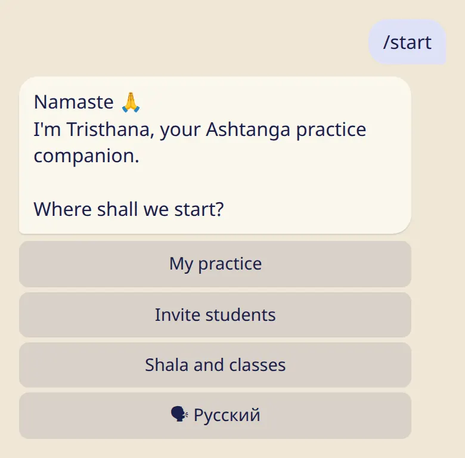
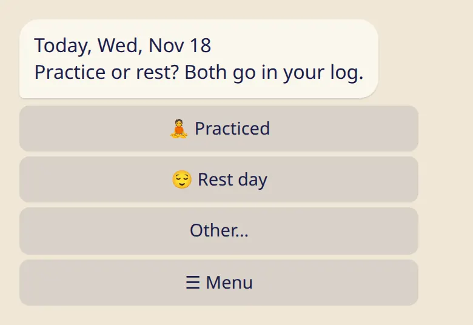
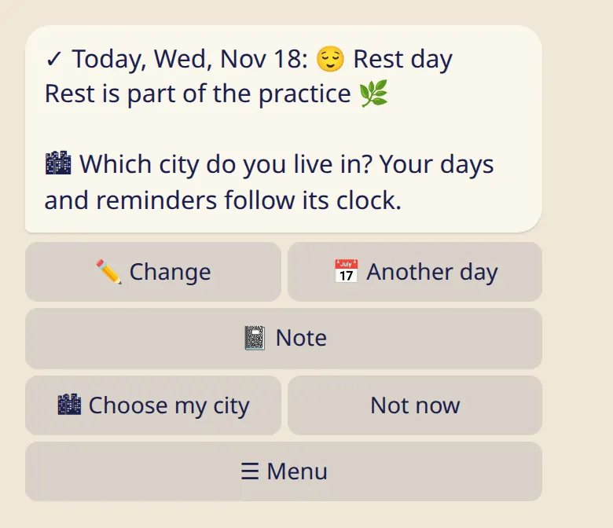

Open the bot, say where to start and log your first day. It takes about two minutes.

## Steps

1. Open [@tristhana_bot](https://t.me/tristhana_bot) in Telegram and start it.
2. The bot asks :ftl[welcome-ask] Tap :ftl[welcome-path-practice]. If you teach, the other two answers are for you.
3. Now it asks about today. Tap :ftl[status-practiced] or :ftl[status-rest]: both go in your log.
4. After a practice, tap :ftl[practice-done]. That's it, your first day is logged.
5. Under the saved day the bot asks: :ftl[city-ask] Tap :ftl[city-ask-button] and pick it, or :ftl[next-not-now]: then it won't ask again, and the city waits for you in :ftl[menu-settings].

_Pictures of the bot are drawn from its real messages._

## Good to know

- **Three taps today, two from tomorrow.** The first question comes only once. After that the bot opens on today straight away.
- **Yesterday's message?** If you tap the buttons of a Today message from an earlier day, the bot asks which day it is for: today, or the date on that message. Nothing lands on the wrong day.
- **Another day.** Today ends with :ftl[log-another-day], next to :ftl[menu-open], for a day you haven't logged yet.
- **No sign-up, no commands to learn.** Your account is created the moment you start the bot. Everything else is behind :ftl[menu-open], :ftl[menu-asanas] included.
- **Notes.** The bot reads buttons, not typed messages. To keep a note on a day, log the day and tap :ftl[diary-button].
- **Language.** The bot starts in your Telegram language. The button with the other language's name on the first screen switches it, and you can change it later in :ftl[menu-settings].
- **Your city's time.** Your city sets the clock for your days and reminders. Pick it when the bot asks, or any time in :ftl[menu-settings]. Opening the app once also tells the bot your phone's time.

## The app's three tabs

- :ftl[tab-today]: log the day in one tap.
- :ftl[tab-practice]: this month's calendar, your year and your asanas.
- :ftl[tab-shala]: your shala, your teacher and your students, with what there is to do first.

## Next

- [The bot and the app](../bot-and-app/): which one is for what.
- [Log a practice](../../students/log-practice/): details, earlier days, changes.
