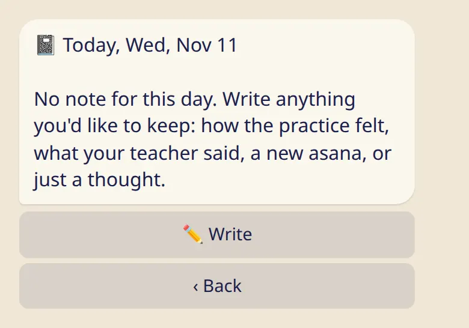

A few taps on how the practice felt, and a private note for anything you want to remember.

## Check-in

Right after you log today's practice, the bot shows a row of faces. Tap one, or skip it.

- **Mood:** five faces.
- **⚡ Energy** and **🔥 Effort:** from 1 to 5.
- :ftl[checkin-tags-open]: words like :ftl[checkin-tag]{from=bot tag=open}, :ftl[checkin-tag]{from=bot tag=stiff} or :ftl[checkin-tag]{from=bot tag=calm}.

Everything is optional. For an earlier practice day, open the day and tap :ftl[checkin-edit].

Don't want the question? :cmd[settings] → :ftl[settings-checkin-off].

## Diary

Every day can have one private note: after a practice, on a rest day, any day.

1. Open the day (:cmd[log]) and tap :ftl[diary-button].
2. Tap :ftl[diary-write] and send your note as a reply to the bot's message.

In the app, the same note is on the day's card under :ftl[diary-title]{from=app}.

## Good to know

- Check-ins and diary notes are only yours. No teacher or shala sees them.
- Diary notes are stored encrypted.
- A note written in the bot also stays in your Telegram chat until you delete the message there.
- A note can be up to 2000 characters of plain text.
- Tristhana doesn't draw conclusions from what you write or tap. It just keeps it for you.

## Next

- [Your data: privacy, export, delete](../your-data/)
