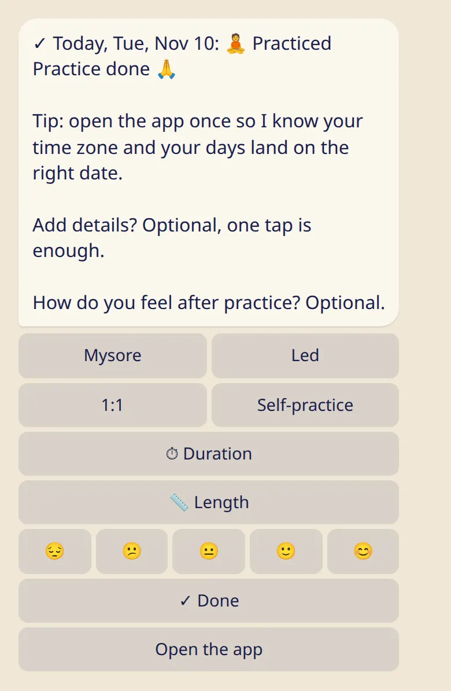

Log today, yesterday or any earlier day, and add as much detail as you like: where, how far, how long.

## Log today

### In the bot

1. Send :cmd[log] (or :cmd[start]).
2. Tap how the day went. For a practice, tap :ftl[status-practiced].
3. Done. The bot shows what it saved.

### In the app

Open the app and tap a status on the :ftl[today-title] card.

## Add details (optional)

One tap is enough. If you'd like more, right after logging a practice you can add:

- **Where:** :ftl[context-mysore], :ftl[context-led], :ftl[context-private] or :ftl[context-self]. Add :ftl[practice-online] if it was online.
- **How far:** :ftl[practice-length]{from=bot} offers :ftl[preset-short], :ftl[preset-half-primary] and :ftl[preset-full-primary]. :ftl[preset-other] lets you pick the series and your last asana.
- **How long:** :ftl[practice-duration]{from=bot}, from 30 minutes to 3 hours.
- **Start time:** in the app only.

:ftl[practice-same-as-last] copies the details of your previous practice in one tap. A led class doesn't count: after one, the button offers the practice before it.

## Log an earlier day

- **In the bot:** tap :ftl[log-another-day], then pick the day. :ftl[log-earlier] goes further back.
- **In the app:** open :ftl[stats-open], tap a day in the month calendar and choose its status.

## Change or clear a day

Open the day again. :ftl[log-change] picks another status, :ftl[log-clear]{from=bot} removes the entry. Changing a practice day to rest also removes its details.

## Good to know

- A short practice counts. Sun salutations, standing and finishing are a practice.
- :ftl[status-skipped] is an honest answer, not a mark against you. Days you don't log aren't counted anywhere.
- One practice per day.
- If dates look a day off, open the app once so the bot learns your time zone.

## Next

- [Rest days, moon days and 🌸](../rest-and-moon-days/)
- [My asanas](../my-asanas/): log your length in fewer taps.
