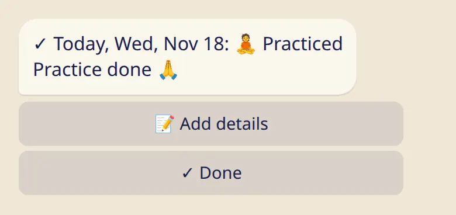
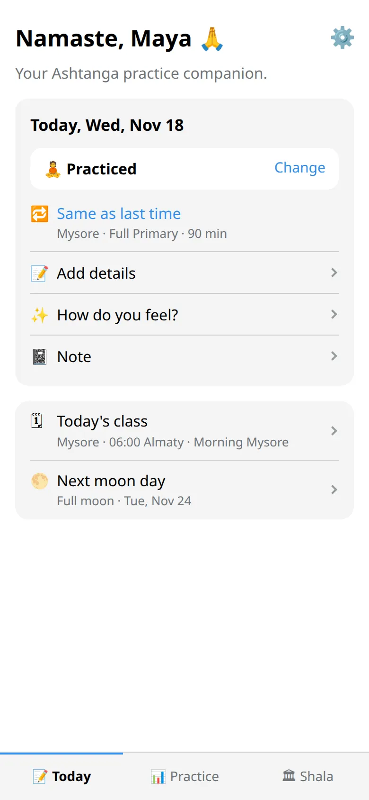
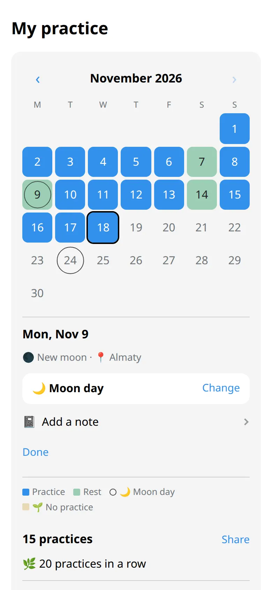

Log today, yesterday or any earlier day, and add as much detail as you like: where, how far, how long.

## Log today

### In the bot

1. Tap :ftl[menu-open] → :ftl[menu-today].
2. Tap how the day went: :ftl[status-practiced], :ftl[status-rest], or :ftl[today-other] for a moon day and everything else.
3. After a practice, tap :ftl[practice-done]. The bot shows what it saved.

### In the app

On the :ftl[tab-today] tab, tap :ftl[status-practiced], :ftl[status-rest] or :ftl[today-other]. The day is saved at once.

## Add details (optional)

The steps above are enough. If you'd like more, tap :ftl[practice-add-details] right after :ftl[status-practiced]. You can add:

- **Where:** :ftl[context-mysore], :ftl[context-led], :ftl[context-private] or :ftl[context-self]. Add :ftl[practice-online] if it was online.
- **How far:** :ftl[practice-length]{from=bot} offers :ftl[preset-short], :ftl[preset-half-primary] and :ftl[preset-full-primary]. :ftl[preset-other] lets you pick the series and your last asana.
- **How long:** :ftl[practice-duration]{from=bot}, from 30 minutes to 3 hours.
- **Start time:** in the app only.

:ftl[practice-same-as-last] copies the details of your previous practice in one tap. It leaves out a Led class: after one, it offers the practice before it. The line above the buttons shows what will be copied, and names the day if that practice was a while ago.

In the app the card folds into one line that says what you logged, and these are rows under it. Nothing opens until you tap it.

## Log an earlier day

- **In the bot:** tap :ftl[log-another-day] under a saved day, or :ftl[menu-help] → :ftl[help-earlier-day]. Pick the day. :ftl[log-earlier] goes further back.
- **In the app:** open the :ftl[tab-practice] tab and tap a day in the month's calendar, up to today. Its card opens right under the calendar, the same card as on the :ftl[tab-today] tab. On a moon day it also says whether the moon is full or new, and for which city.

## Change or clear a day

Under a saved day, tap :ftl[log-change]. Then pick another status, or tap :ftl[log-clear]{from=bot} to remove the entry. Changing a practice day to rest also removes its details. In the app, tap :ftl[today-change] on the day's card, then another choice, or :ftl[today-clear].

## Good to know

- A short practice counts. Sun salutations, standing and finishing are a practice.
- :ftl[status-skipped] is an honest answer, not a mark against you. Days you don't log aren't counted anywhere.
- One practice per day.
- If dates look a day off, open the app once so the bot learns your city's time.

## Next

- [Rest days, moon days and 🌸](../rest-and-moon-days/)
- [My asanas](../my-asanas/): say how far you went in fewer taps.
