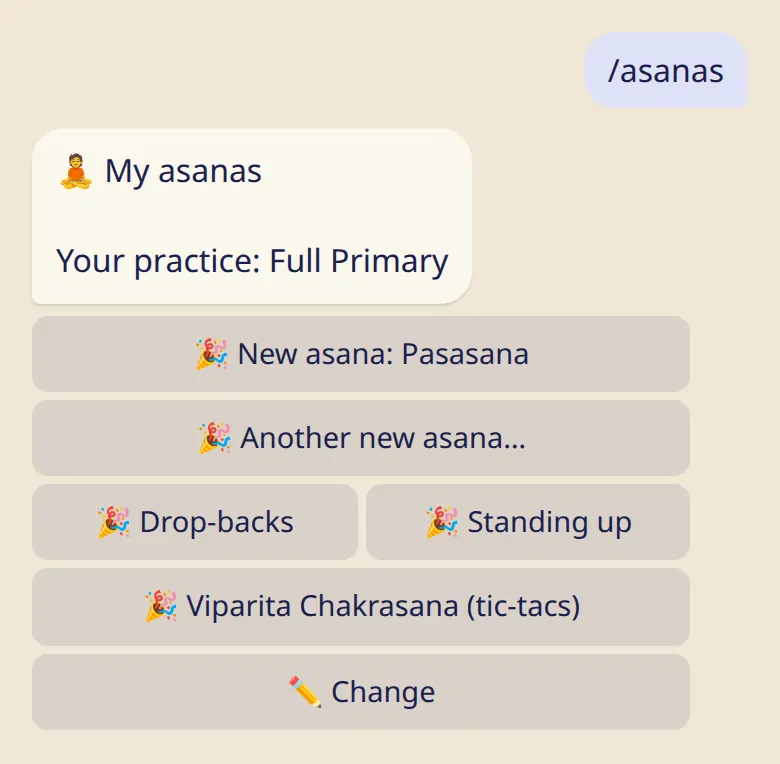
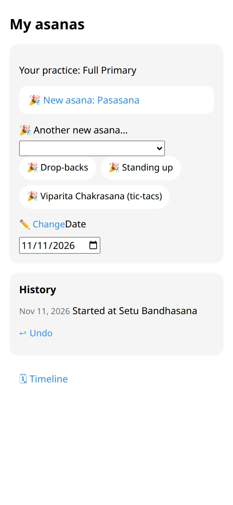

Keep track of your last asana, mark a new one when your teacher gives it, and look back at how things unfolded.

## Set where your practice ends

1. Send :cmd[asanas], or tap :ftl[progression-open] in the app.
2. The first time, pick the series and your last asana.

From then on, :ftl[practice-length]{from=bot} also offers your own practice when you log.

## A new asana 🎉

When your teacher gives you the next asana, open :cmd[asanas] and tap the button with its name. Got more than one? :ftl[progression-new-other] lets you choose.

Drop-backs, standing up from a backbend and tic-tacs have their own buttons. Mark them whenever they come, in any order.

## Fix a mistake

- :ftl[progression-undo] takes back the last mark.
- :ftl[progression-change] sets where your practice ends now, without a celebration. Use it after a break, or if you tapped the wrong asana.

## When your teacher marks it

A teacher on your list can mark a new asana for you. The bot tells you who did it, and you can undo it if it doesn't match.

## Look back

In the app, :ftl[timeline-open] shows your asanas with their dates, newest first.

## Good to know

- You mark asanas yourself, on trust. Nothing is "unlocked", and nobody checks.
- A teacher on your list sees where your practice ends now. They don't see the history.

## Next

- [My teacher](../my-teacher/)
