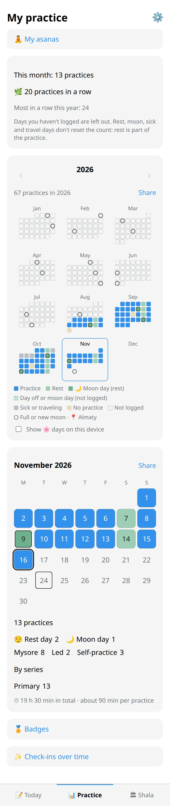
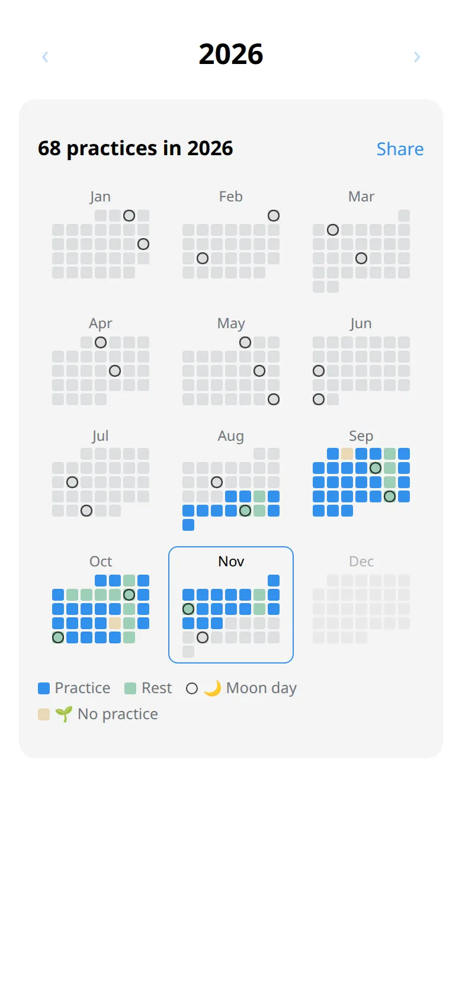
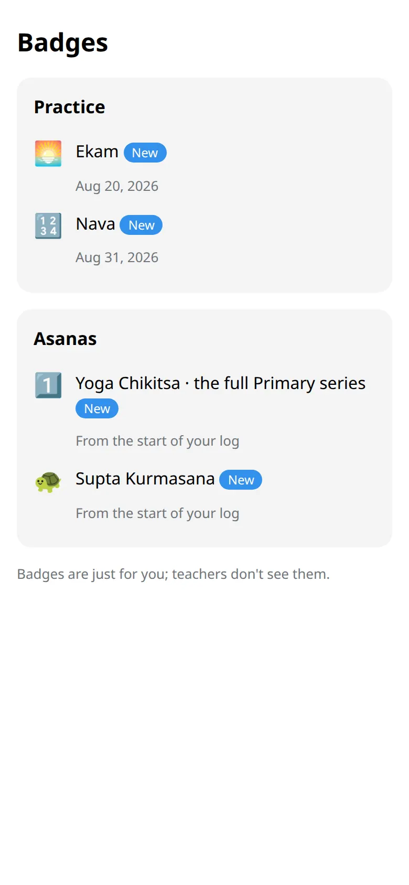
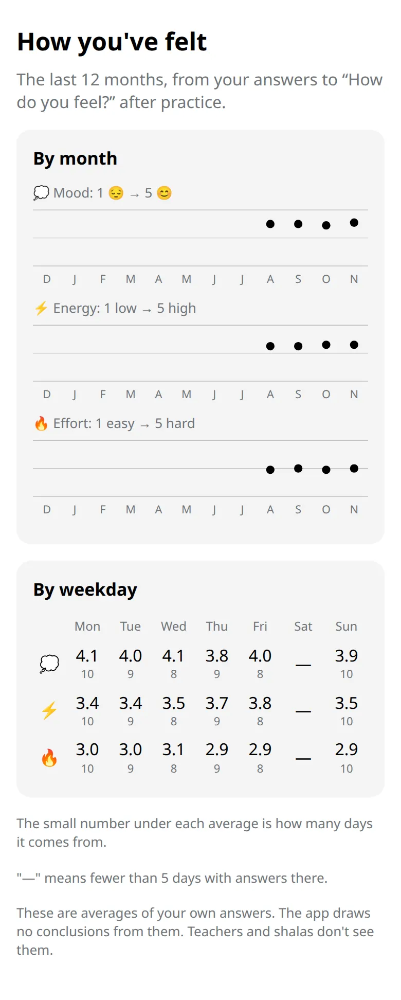

Your month at a glance, the year one tap away, quiet badges, and cards you can share if you feel like it.

## Open it

Open the app and tap the :ftl[tab-practice] tab. It opens on this month. The arrows next to the month's name lead to other months.

## What you see

- **Four marks:** :ftl[stats-legend-practiced], :ftl[stats-legend-rest], :ftl[status-moon] (a ring around the date) and :ftl[status-skipped]. A day with nothing logged is just a number.
- **One line under the calendar:** the month's practices. In a month of rest it says :ftl[stats-month-rest] The current month also shows how many practices came in a row.
- :ftl[stats-more] opens the rest: rest by kind, where you practiced, which series and the total time.
- **The year** is the row under :ftl[progression-open]: twelve small months with the same marks. Tap a month to open it.

Tap a day to log it or change it: see [Log a practice](../log-practice/).

## Badges

Tap :ftl[badges-open] at the bottom. You see only the badges you have earned, and when. They are just for you: teachers don't see them, and there is no ranking.

## How you've felt

Tap :ftl[trends-open] at the bottom. It shows the averages of your answers to :ftl[checkin-edit] after practice for the last 12 months: by month, by weekday, and on the days around a full or new moon next to all other days. The small number under each average is how many days it comes from.

The screen shows your numbers and draws no conclusions from them. Averages appear once you've answered on 10 days. A month, a weekday or a moon column needs 5 days, and shows a dash until then. This screen is yours alone: teachers and shalas don't see it.

## Share a card

:ftl[share-open] next to the month's practices or the year's total makes a picture for a story or a post. You can share it to a story, save it, or send it to your own chat. The card shows your practice days and nothing else: no name, no notes, no reasons for rest.

## Good to know

- At 100, 365 and 1000 practices the bot says a quiet thank-you. Nobody is compared with anyone.
- Rest of any kind doesn't reset the practices in a row.
- With a :ftl[status-skipped] day in the month, :ftl[stats-more] also says, for example, :ftl[stats-consistency]{x=9 y=10}. Rest and empty days are left out of it.
- 🌸 days look like rest on the calendar. To mark them there, see [Rest days, moon days and 🌸](../rest-and-moon-days/).

## Next

- [My asanas](../my-asanas/)
