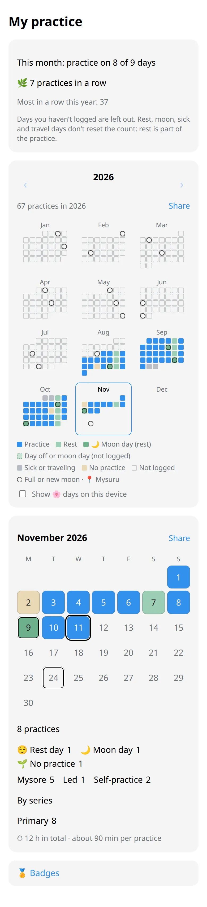
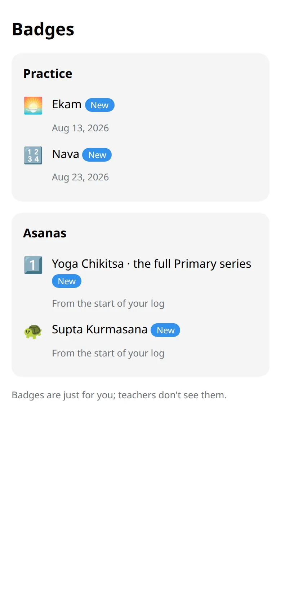
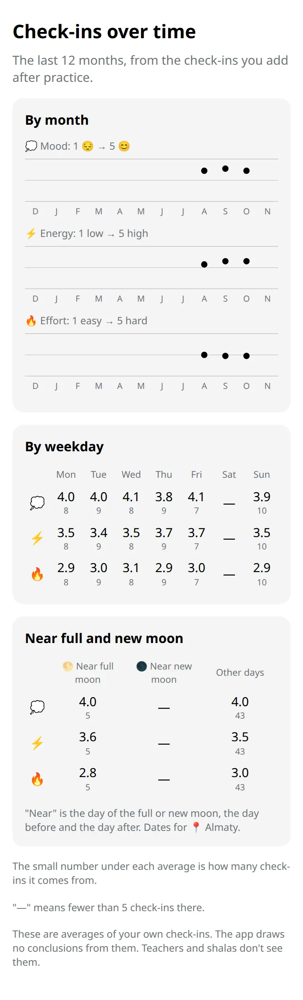

Your year at a glance, a summary of each month, quiet badges, and cards you can share if you feel like it.

## Open it

Open the app and tap :ftl[stats-open].

## What you see

- **The year.** Twelve small months. A filled square is a practice; softer colours are rest, moon days, illness or travel. A ring marks a full or new moon.
- **This month in words.** For example, practice on 9 of 10 days. The second number counts only the days you logged as practice or :ftl[status-skipped]. Rest and days you didn't log are left out.
- **In a row.** How many practices came one after another. Rest, moon days, illness and travel don't reset it.
- **The month.** A calendar, then a summary: practices, where you practiced, which series, total time.

Tap a day in the month calendar to log it or change it.

## Badges

Tap :ftl[badges-open] at the bottom. You see only the badges you have earned, and when. They are just for you: teachers don't see them, and there is no ranking.

## Check-ins over time

Tap :ftl[trends-open] at the bottom. It shows the averages of your after-practice check-ins for the last 12 months: by month, by weekday, and on the days around a full or new moon next to all other days. The small number under each average is how many check-ins it comes from.

The screen shows your numbers and draws no conclusions from them. Averages appear from 10 check-ins. A month, a weekday or a moon column needs 5, and shows a dash until then. This screen is yours alone: teachers and shalas don't see it.

## Share a card

:ftl[share-open] next to the year or the month makes a picture for a story or a post. You can share it to a story, save it, or send it to your own chat. The card shows your practice days and nothing else: no name, no notes, no reasons for rest.

## Good to know

- At 100, 365 and 1000 practices the bot says a quiet thank-you. Nobody is compared with anyone.
- 🌸 days look like rest here unless you choose to show them on your phone.

## Next

- [My asanas](../my-asanas/)
