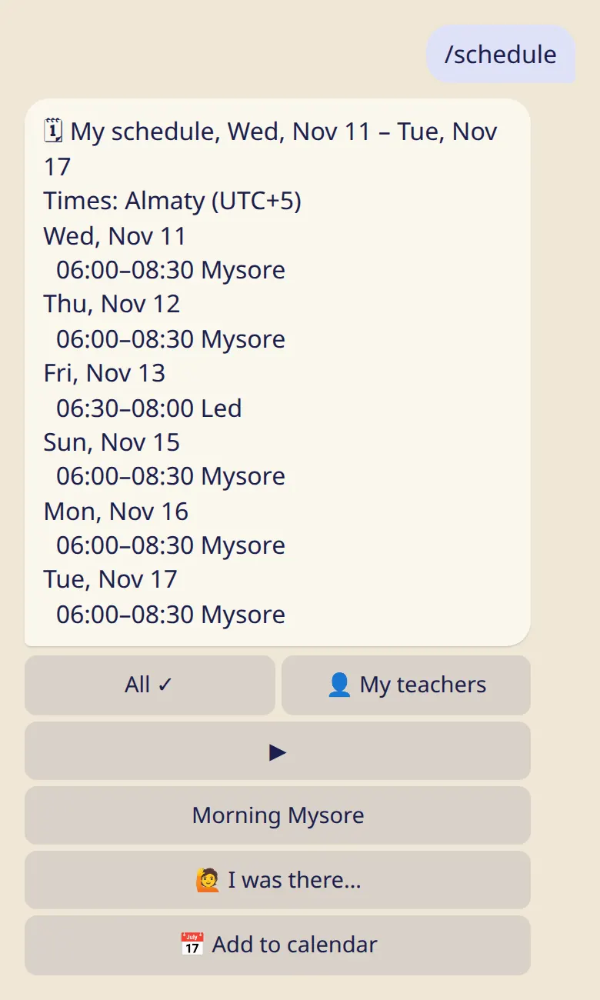
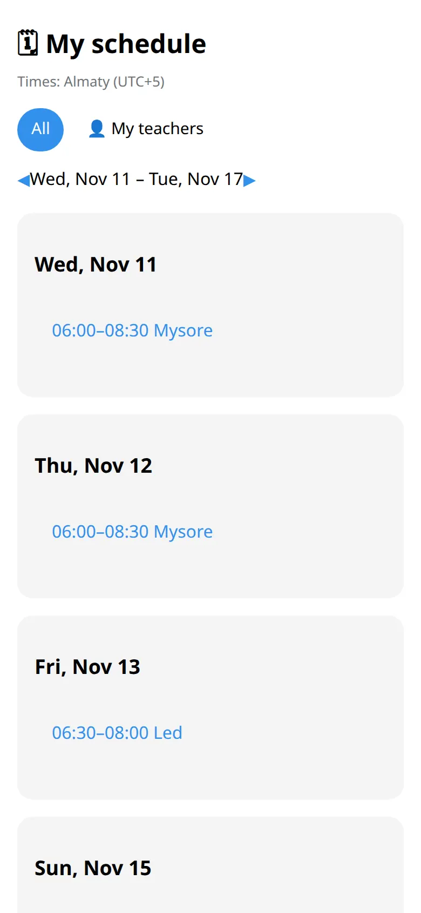

Join a shala, see its classes in your own time zone, add them to your calendar and mark the classes you came to.

## Join

1. Your shala shares a link or a QR code.
2. Open it. The bot shows the shala and what joining means.
3. Tap :ftl[shala-join-yes].

The shala's teachers and staff see your name, and nothing from your log. The staff can send announcements, and you can mute them. Your moon days may follow the shala's calendar: see [Rest days, moon days and 🌸](../rest-and-moon-days/).

## Your schedule

- **In the bot:** :cmd[schedule] shows this week's classes at all your shalas.
- **In the app:** tap :ftl[my-schedule-open]{from=app} for the whole week, and the weeks after it.

Times are shown in your own time zone, with its name. If a shala is in another zone, you see both times. A 🌙 next to a date is one of your moon days.

## Add it to your calendar

Under :cmd[schedule], tap :ftl[feed-open]. You get a personal link for Google, Apple or Outlook Calendar with your classes and your moon days. It updates by itself.

The link is private: anyone who has it sees your schedule. If it got out, :ftl[feed-rotate] makes a new one.

## Mark a class you came to

Under :cmd[schedule], tap :ftl[attend-me-open] and choose the class. You can mark today and the six days before. The shala's staff can confirm your mark, or mark you themselves.

Attendance is separate from your practice log. Marking a class doesn't log a practice, and nothing ever shows that you were absent.

## Leave

:cmd[teachers] → the shala → :ftl[shala-leave]. Nobody gets a message, and your log stays as it is.

## Next

- [Settings and your city](../settings/)
