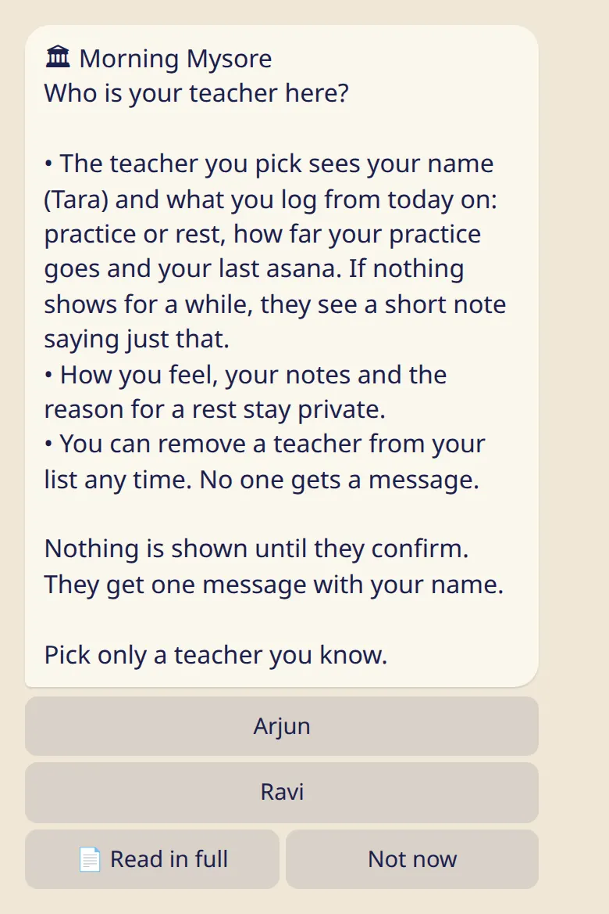
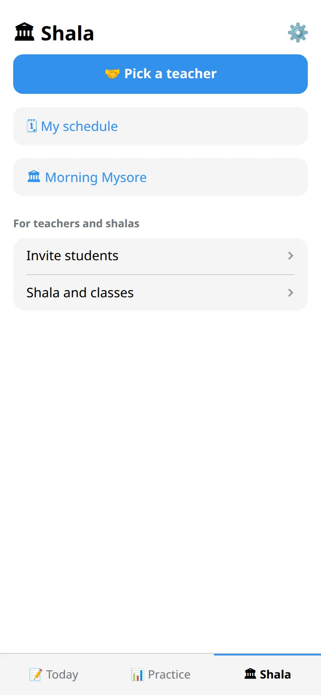
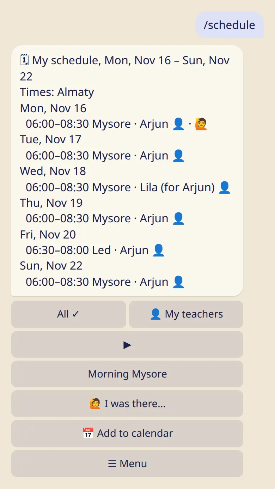
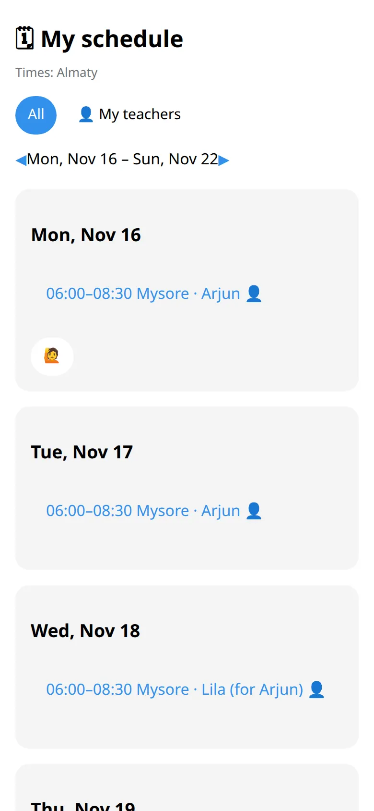

Join a shala, see its classes in your own city's time, add them to your calendar and mark the classes you came to.

## Join

1. Your shala sends you a link or shows a QR code.
2. Open it. The bot shows the shala and, in short, what joining means. :ftl[consent-details] has the full text.
3. Tap :ftl[shala-join-yes].

The shala's teachers and staff see your name, and nothing from your log. The staff can send announcements, and you can mute them. Your moon days may follow the shala's calendar: see [Rest days, moon days and 🌸](../rest-and-moon-days/).

## Who is your teacher here?

Right after you join, the bot asks :ftl[request-ask] and shows the shala's teachers. The same screen says, in short, what your teacher would see.

1. Tap your teacher's name. If the shala has one teacher, the bot asks about them by name: tap :ftl[request-yes].
2. Your teacher gets one message with your name. When they confirm, they are on your list of teachers.

- Until your teacher confirms, they see nothing from your log.
- Not sure yet? Tap :ftl[invite-decline]. The question stays on the shala's card, under :ftl[request-open]{from=bot}. It is there too if you joined a while ago.
- No question? Then there is nobody to pick at this shala right now.

In the app, while you have no teacher, :ftl[request-open]{from=app} is the first row of the :ftl[tab-shala] tab. It asks the same question.

What comes next, and how to take a request back: [My teacher](../my-teacher/).

## Your schedule

- **In the bot:** :ftl[menu-open] → :ftl[menu-classes] shows this week's classes at all your shalas.
- **In the app:** on the :ftl[tab-shala] tab, tap :ftl[my-schedule-open]{from=app} for the whole week, and the weeks after it. Today's class is also a line on the :ftl[tab-today] tab.

Times are shown by your city's clock, with the city named. If a shala keeps another city's time, you see both times. A 🌙 next to a date is one of your moon days.

## Add it to your calendar

Under the schedule in the bot, tap :ftl[feed-open]. You get a personal link for Google, Apple or Outlook Calendar with your classes and your moon days. It updates by itself.

The link is private: anyone who has it sees your schedule. If it got out, :ftl[feed-rotate] makes a new one.

## Mark a class you came to

Under the schedule in the bot, tap :ftl[attend-me-open] and choose the class. You can mark today and the six days before. The shala's staff can confirm your mark, or mark you themselves.

Attendance is separate from your practice log. Marking a class doesn't log a practice, and nothing ever shows that you were absent.

## Leave

Open :ftl[menu-teacher], tap the shala, then :ftl[shala-leave] and confirm. Nobody gets a message, and your log stays as it is.

## Next

- [Settings and your city](../settings/)
