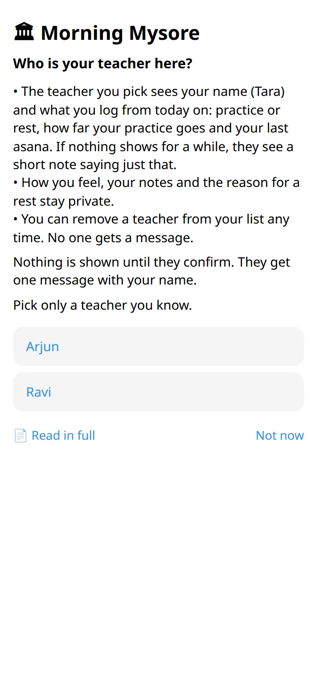
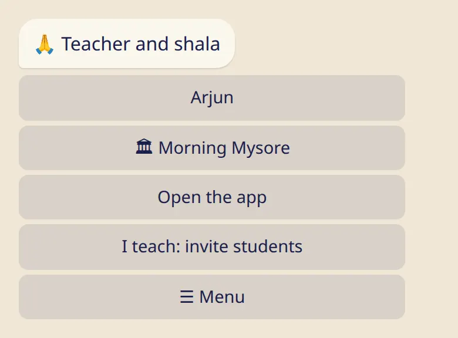
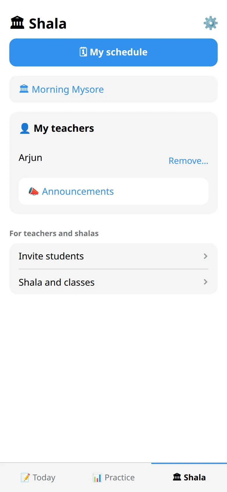

Connect with your teacher by their link or through your shala, and see exactly what they can and can't see.

## Add your teacher

1. Your teacher sends you a link or shows a QR code.
2. Open it. The bot shows who is inviting you and, in a few lines, what they would see. :ftl[consent-details] has the full text.
3. Tap :ftl[invite-accept], or :ftl[invite-decline]. If you decline, your teacher isn't told.

Accept only if you know the person: anyone can type any name.

## Pick your teacher at your shala

No link from your teacher? If they teach at your shala, you can pick them in the app or in the bot.

1. In the app, open the :ftl[tab-shala] tab and tap :ftl[request-open]{from=app}: while you have no teacher, it is the first row. It is also on your shala's card, in the app and in the bot (:ftl[menu-open] → :ftl[menu-teacher] → your shala).
2. Tap your teacher's name. The screen says in short what they would see, and :ftl[consent-details] has the full text.
3. Your teacher confirms. Until then, the :ftl[tab-shala] tab and the shala's card say :ftl[request-waiting-line]{from=app name=Arjun}.

- Nothing from your log is shown until your teacher confirms. They get one message with your name.
- When they confirm, the bot tells you. They see your days from the day you asked.
- No answer after 7 days? The bot tells you, once. Ask them in class, or tap :ftl[request-pick-another].
- To take a request back, tap :ftl[request-withdraw-short] under that line. Nobody gets a message.
- You can ask up to three teachers in a week, and the same teacher again in about a month.
- Pick only a teacher you know.

The bot asks the same question right after you join a shala: see [My shala](../my-shala/).

## What your teacher sees

- your name;
- what you log from the day you add them, or the day you asked them at your shala: practice or rest, and how far you went;
- your last asana;
- if nothing shows for a while, one short line saying just that.

## What stays with you

- your answers about how you feel, and your notes;
- the reason for a rest day. All rest looks the same to a teacher, whatever it was;
- everything you logged before you added them;
- your badges.

## Your list

:ftl[menu-open] → :ftl[menu-teacher] shows your teachers and your shalas, and :ftl[app-open-shala] opens the same in the app, on the :ftl[tab-shala] tab. If you teach too, people waiting for your answer are on top of this screen: :ftl[request-waiting-open]{count=2}.

- You can have several teachers. ⭐ marks your main one. If you haven't chosen a city yourself, your moon days follow your shala's. If your main teacher isn't on your shala's staff and has chosen a city, they follow that city instead. Without a shala, they follow the city your main teacher chose, and otherwise Mysuru. See [Rest days, moon days and 🌸](../rest-and-moon-days/).
- Tap a name, then :ftl[links-remove]{from=bot} to take them off your list. Nobody gets a message.

## Messages from your teacher

A teacher can send a short announcement to all their students through the bot. Tap :ftl[ann-mute] under one if you'd rather not receive them. Nobody is told, and you can still read them under :ftl[ann-list]{from=bot}.

## Good to know

- Your log works exactly the same with or without a teacher.
- A teacher can mark a new asana for you. You get a message and can undo it.

## Next

- [My shala: schedule, calendar, attendance](../my-shala/)
