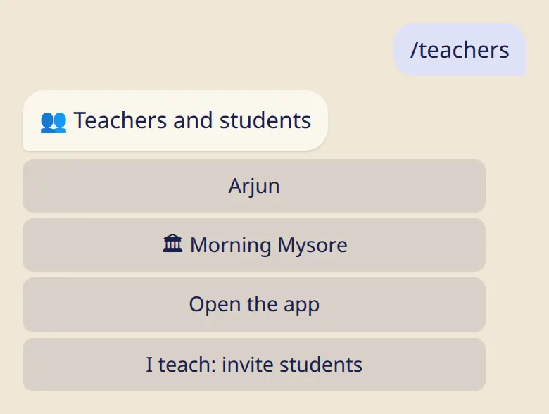

Connect with your teacher with a link or a QR code, and see exactly what they can and can't see.

## Add your teacher

1. Your teacher sends you a link or shows a QR code.
2. Open it. The bot shows who is inviting you and what they would see.
3. Tap :ftl[invite-accept], or :ftl[invite-decline]. If you decline, your teacher isn't told.

Accept only if you know the person: anyone can type any name.

## What your teacher sees

- your name;
- what you log from the day you add them: practice or rest, and your practice length;
- your last asana;
- if nothing shows for a while, a short note saying just that.

## What stays with you

- check-ins and diary notes;
- the reason for a rest day. All rest looks the same to a teacher, whatever it was;
- everything you logged before you added them;
- your badges.

## Your list

:cmd[teachers] shows your teachers and your shalas.

- You can have several teachers. ⭐ marks your main one. If you haven't chosen a city yourself, your moon days follow the city they chose.
- Tap a name, then :ftl[links-remove]{from=bot} to take them off your list. Nobody gets a message.

## Messages from your teacher

A teacher can send a short announcement to all their students through the bot. Tap :ftl[ann-mute] under one if you'd rather not receive them. Nobody is told, and you can still read them under :ftl[ann-list]{from=bot}.

## Good to know

- Your log works exactly the same with or without a teacher.
- A teacher can mark a new asana for you. You get a message and can undo it.

## Next

- [My shala: schedule, calendar, attendance](../my-shala/)
