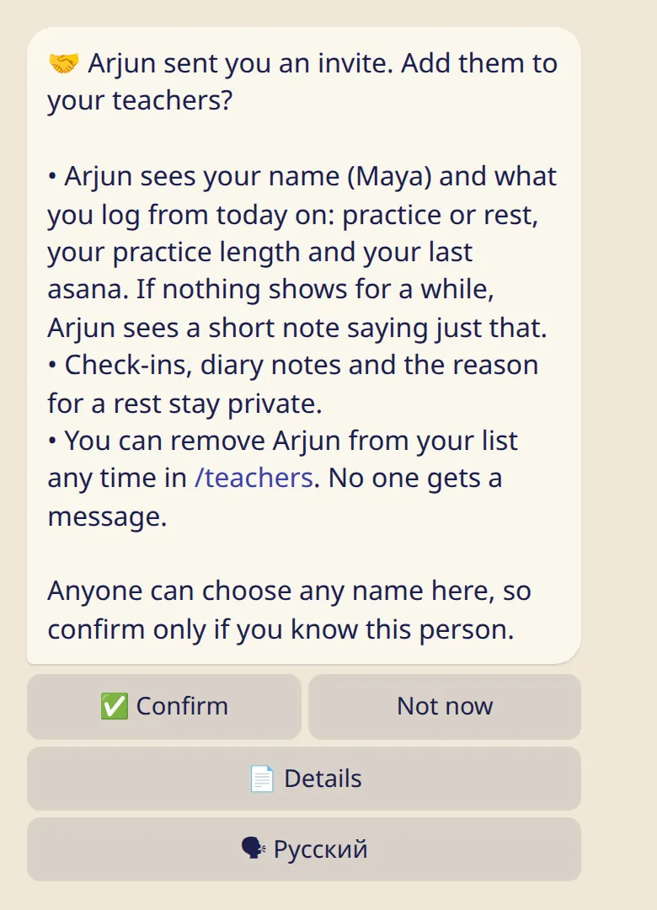

Connect with your teacher by their link or through your shala, and see exactly what they can and can't see.

## Add your teacher

1. Your teacher sends you a link or shows a QR code.
2. Open it. The bot shows who is inviting you and, in a few lines, what they would see. :ftl[consent-details] has the full text.
3. Tap :ftl[invite-accept], or :ftl[invite-decline]. If you decline, your teacher isn't told.

Accept only if you know the person: anyone can type any name.

## Pick your teacher at your shala

No link from your teacher? If they teach at your shala, you can pick them in the bot.

1. Open :ftl[menu-open] → :ftl[menu-teacher] and tap your shala.
2. Tap :ftl[request-open], then your teacher's name. :ftl[consent-details] has the full text of what they would see.
3. Your teacher confirms. Until then the shala's card says :ftl[request-waiting-line]{from=bot name=Arjun}.

- Nothing from your log is shown until your teacher confirms. They get one message with your name.
- When they confirm, the bot tells you. They see your days from the day you asked.
- No answer after 7 days? The bot tells you, once. Ask them in class, or tap :ftl[request-pick-another].
- To take a request back, tap :ftl[request-withdraw]{from=bot name=Arjun} on the shala's card, or :ftl[request-withdraw]{from=app} on the :ftl[tab-shala] tab in the app. Nobody gets a message.
- You can ask up to three teachers in a week, and the same teacher again in about a month.
- Pick only a teacher you know.

The bot asks the same question right after you join a shala: see [My shala](../my-shala/).

## What your teacher sees

- your name;
- what you log from the day you add them, or the day you asked them at your shala: practice or rest, and your practice length;
- your last asana;
- if nothing shows for a while, a short note saying just that.

## What stays with you

- check-ins and diary notes;
- the reason for a rest day. All rest looks the same to a teacher, whatever it was;
- everything you logged before you added them;
- your badges.

## Your list

:ftl[menu-open] → :ftl[menu-teacher] shows your teachers and your shalas. In the app they are on the :ftl[tab-shala] tab.

- You can have several teachers. ⭐ marks your main one. If you haven't chosen a city yourself, your moon days follow the city they chose. If your main teacher teaches at your shala, the shala's calendar comes first.
- Tap a name, then :ftl[links-remove]{from=bot} to take them off your list. Nobody gets a message.

## Messages from your teacher

A teacher can send a short announcement to all their students through the bot. Tap :ftl[ann-mute] under one if you'd rather not receive them. Nobody is told, and you can still read them under :ftl[ann-list]{from=bot}.

## Good to know

- Your log works exactly the same with or without a teacher.
- A teacher can mark a new asana for you. You get a message and can undo it.

## Next

- [My shala: schedule, calendar, attendance](../my-shala/)
