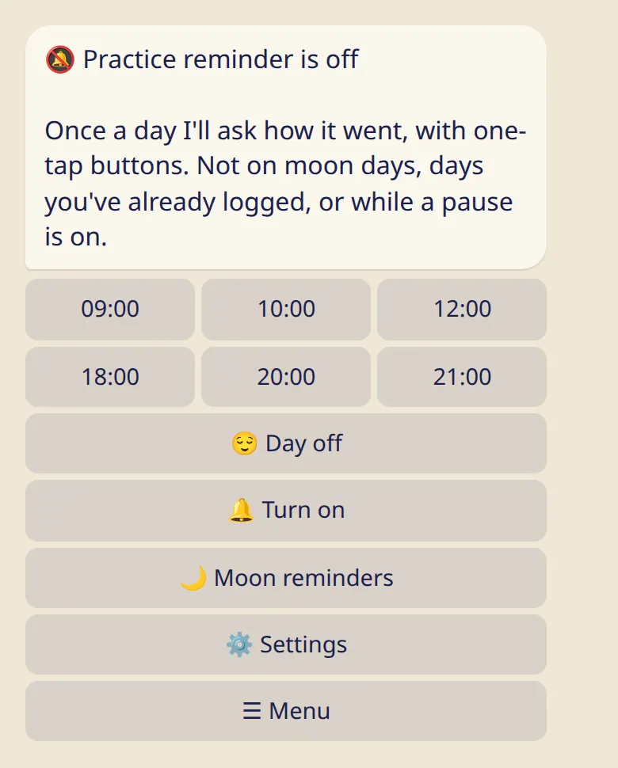
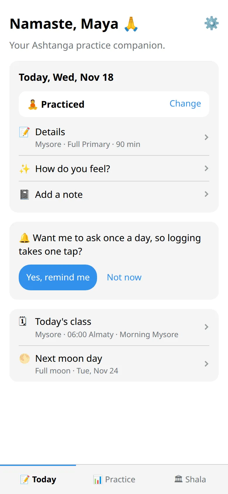
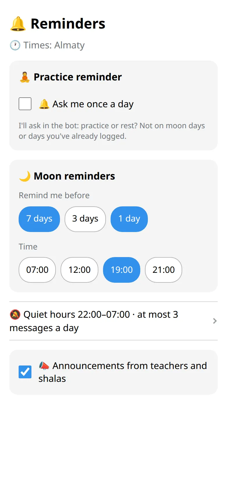

A gentle daily nudge to log your practice, and a heads-up before moon days. You choose the time, and you can turn them off at any time.

## The daily practice reminder

1. Open :ftl[menu-open] → :ftl[menu-help] and tap :ftl[help-reminder].
2. Pick a time and tap :ftl[remind-turn-on].

The app offers it too, on the :ftl[tab-today] tab, once you have logged a day: :ftl[next-reminder-do] turns it on in one tap, :ftl[next-not-now] puts the question away. Later it is behind the gear :ftl[settings-open]{from=app} → :ftl[settings-reminders-button].

Once a day the bot asks how it went. You answer with one tap:

- :ftl[remind-same] logs a practice with the same details as before;
- :ftl[remind-practiced] lets you add details;
- :ftl[status-rest] logs a rest day;
- :ftl[remind-other] opens the full list.

The reminder does not come on your day off, on moon days, on days you have already logged, or during a pause (sick, traveling or 🌸).

## Moon day reminders

They are on from the start: 7 days and 1 day before each moon day, at 19:00 your time. Change the days or turn them off under :ftl[menu-moon] → :ftl[moon-reminders] in the bot, or under :ftl[remind-moon-title] on the app's :ftl[settings-reminders-button] page.

## Quiet hours and a daily limit

Reminders don't come between 22:00 and 07:00, and the bot sends at most 3 of them a day. Both can be changed in the app: the gear → :ftl[settings-reminders-button] → :ftl[settings-quiet].

## Good to know

- Reminders are off until you turn them on. The bot offers once, after your first practice: :ftl[remind-offer-yes] turns them on in one tap, and :ftl[remind-change-time] picks another hour.
- If you leave ten reminders unanswered, the bot stops asking and says so. Turn them back on the same way.
- A reminder never changes a day you have already logged.
- Reminders need to know your city's time. Open the app once, or choose your city in :ftl[menu-settings].

## Next

- [Settings and your city](../settings/)
