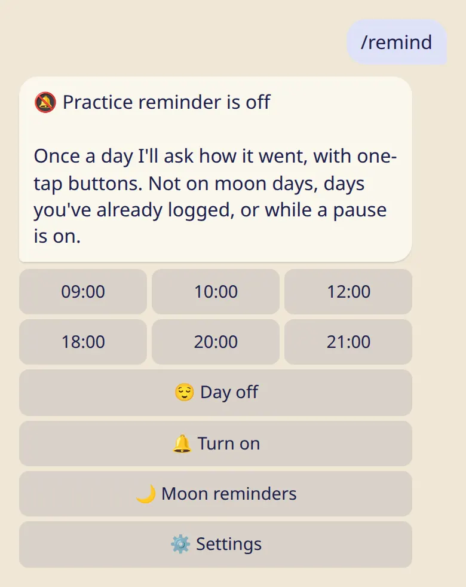

A gentle daily nudge to log your practice, and a heads-up before moon days. You choose the time, and you can turn them off at any time.

## The daily practice reminder

1. Send :cmd[remind].
2. Pick a time and tap :ftl[remind-turn-on].

Once a day the bot asks how it went. You answer with one tap:

- :ftl[remind-same] logs a practice with the same details as before;
- :ftl[remind-practiced] lets you add details;
- :ftl[status-rest] logs a rest day;
- :ftl[remind-other] opens the full list.

The reminder does not come on your day off, on moon days, on days you have already logged, or during a pause (sick, traveling or 🌸).

## Moon day reminders

They are on from the start: 7 days and 1 day before each moon day, at 19:00 your time. Change the days or turn them off in :cmd[moon] → :ftl[moon-reminders].

## Quiet hours and a daily limit

Reminders don't come between 22:00 and 07:00, and the bot sends at most 3 of them a day. Both can be changed in the app: :ftl[settings-open]{from=app} → :ftl[settings-quiet].

## Good to know

- Reminders are off until you turn them on. The bot offers to turn them on once, after your first practice.
- If you leave ten reminders unanswered, the bot stops asking and says so. :cmd[remind] brings it back.
- A reminder never changes a day you have already logged.
- Reminders need your time zone. Open the app once, or choose your city in :cmd[settings].

## Next

- [Settings and your city](../settings/)
