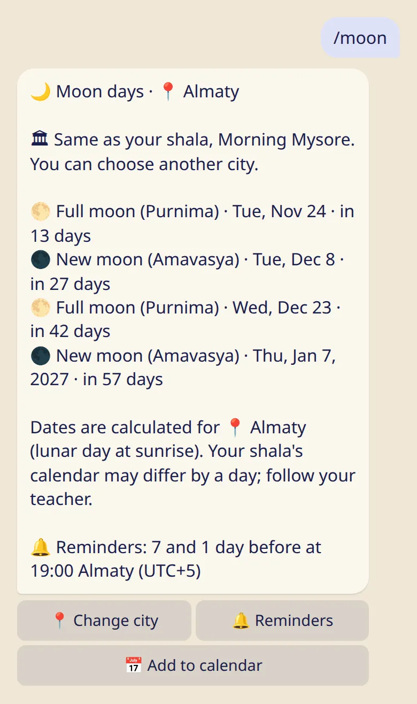
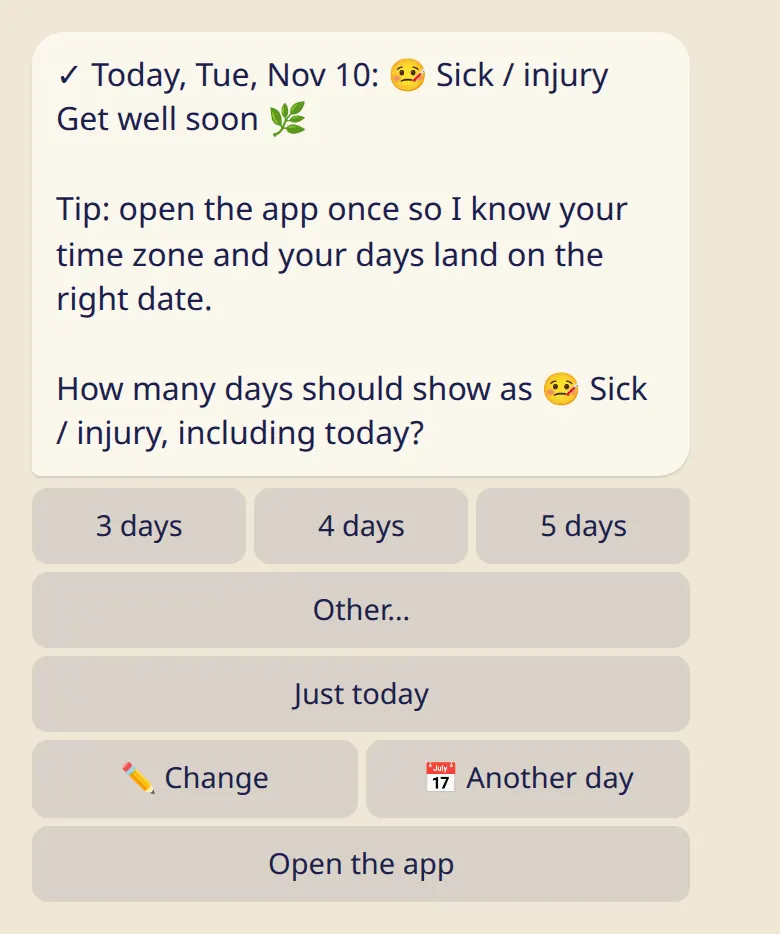

Rest is part of the practice. Here is how days off, moon days, 🌸 days, sick days and travel work.

## The kinds of rest

When you log a day you can choose :ftl[status-rest], :ftl[status-moon], :ftl[status-ladies], :ftl[status-sick] or :ftl[status-travel]. None of them interrupts your count of practices in a row.

## Your weekly day off

1. Send :cmd[settings] and tap :ftl[settings-day-off-button].
2. Pick one or two days. The other days are your practice days.

From then on your day off shows as rest by itself, and practice reminders skip it. If you practiced on a day off, just log it: what you log always wins.

## Moon days

In Ashtanga we traditionally rest on full and new moon days. Tristhana fills them in for you as :ftl[status-moon].

- :cmd[moon] shows the next moon days and the city they are calculated for.
- If you chose a city yourself, the dates follow it. Otherwise they follow the city your main teacher chose, then your shala's calendar, then Mysuru. If your main teacher teaches at your shala, the shala's calendar comes first.
- You get a reminder 7 days and 1 day before, at 19:00 your time. :ftl[moon-reminders] changes that or turns it off.

Moon days depend on the place, so two cities can differ by a day. If your shala's calendar says something else, follow your teacher.

## Several days: sick, traveling or 🌸

When you log :ftl[status-sick], :ftl[status-travel] or :ftl[status-ladies] for today, the bot asks how many days. Those days fill in by themselves, and practice reminders pause until they end.

- :ftl[pause-only]{from=bot rel=today} keeps it to one day.
- Feeling better sooner? Log a practice, or end the pause early from :cmd[remind].
- Moon day reminders keep coming during a pause.

## 🌸 Ladies' holiday

- Only you see it. It is stored encrypted, and your teacher and everyone else see an ordinary rest day.
- In your own stats it is shown as rest too, unless you switch on :ftl[stats-show-ladies] on your phone.
- Don't need the button? :cmd[settings] → :ftl[settings-ladies-hide] removes it from the bot and the app.

## Next

- [Reminders](../reminders/)
- [My practice: calendar, month, badges](../my-practice/)
