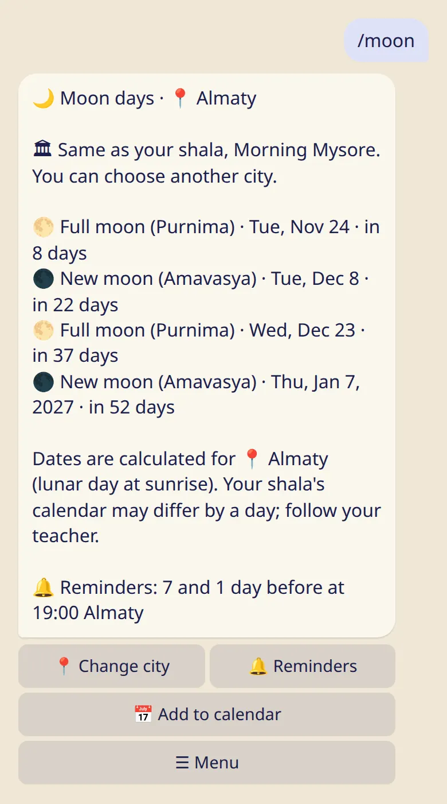
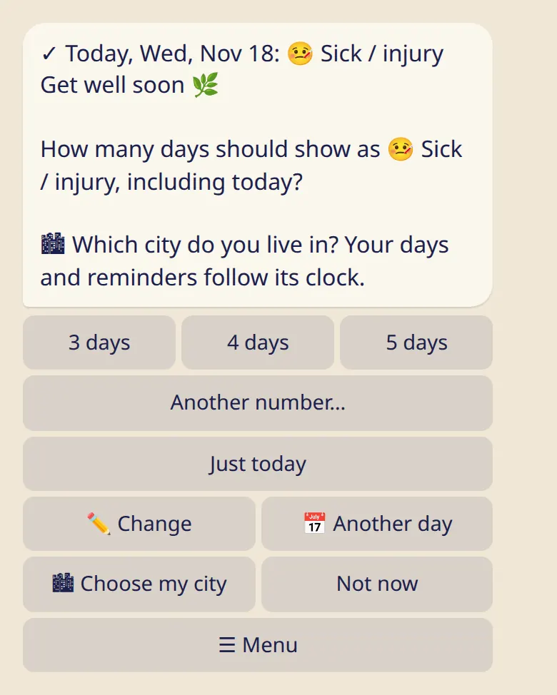

Rest is part of the practice. Here is how days off, moon days, 🌸 days, sick days and travel work.

## The kinds of rest

When you log a day you can choose :ftl[status-rest], or tap :ftl[today-other] for :ftl[status-moon], :ftl[status-ladies], :ftl[status-sick] and :ftl[status-travel]. None of them interrupts your count of practices in a row.

## Your weekly day off

1. Open :ftl[menu-open] → :ftl[menu-settings] and tap the day off row (😌). In the app it is the same row behind the gear.
2. Pick one or two days. The other days are your practice days.

From then on your day off shows as rest by itself, and practice reminders don't come that day. If you practiced on a day off, just log it: what you log always wins.

## Moon days

In Ashtanga we traditionally rest on full and new moon days. Tristhana fills them in for you as :ftl[status-moon].

- :ftl[menu-open] → :ftl[menu-moon] shows the next moon days and the city they are calculated for. In the app, tap the moon line on the :ftl[tab-today] tab.
- If you chose a city yourself, the dates follow it. Otherwise, in a shala, they follow the shala's moon days. If your main teacher isn't on your shala's staff and has chosen a city, they follow that city instead. Without a shala, they follow the city your main teacher chose, and otherwise Mysuru. See [Moon days your students follow](../../teachers/moon-days/).
- You get a reminder 7 days and 1 day before, at 19:00 your time. :ftl[moon-reminders] changes that or turns it off.

Moon days depend on the place, so two cities can differ by a day. If your shala or your teacher announces another day, go by what they say.

## Several days: sick, traveling or 🌸

When you log :ftl[status-sick], :ftl[status-travel] or :ftl[status-ladies] for today, the bot asks how many days. Those days fill in by themselves, and practice reminders pause until they end.

- :ftl[pause-only]{from=bot rel=today} keeps it to one day.
- Feeling better sooner? Log a practice, or tap the button that ends the pause, under today's question.
- Moon day reminders keep coming during a pause.

## 🌸 Ladies' holiday

- Only you see it. It is stored encrypted, and your teacher and everyone else see an ordinary rest day.
- On your own calendar in the app it looks like rest too. The gear → :ftl[settings-more-button] → :ftl[stats-show-ladies] adds a small 🌸 to those days, on this phone only.
- The card of a day you open always shows what you logged, so you can log an earlier 🌸 day from the month.
- Don't need the button? :ftl[menu-settings] → :ftl[settings-more-button] → :ftl[settings-ladies-hide] removes it from the bot and the app. In the app the switch is :ftl[settings-ladies-button], in the same place.

## Next

- [Reminders](../reminders/)
- [My practice: calendar, month, badges](../my-practice/)
