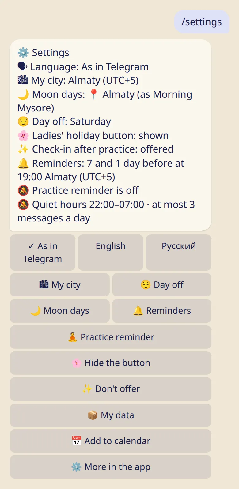
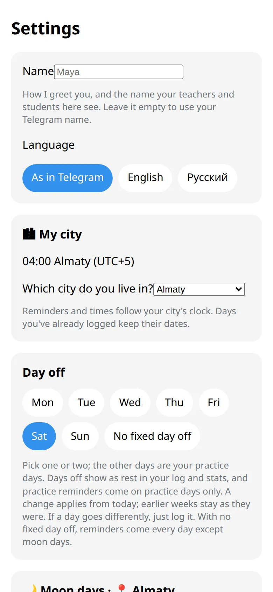

Your name, language, city and time zone, and whose moon days you follow.

## Where the settings are

- **In the bot:** :cmd[settings] shows everything on one screen.
- **In the app:** :ftl[settings-open]{from=app} at the bottom of the first screen. Some things are only here: your name, quiet hours and the daily limit.

## Your city

Your city sets your time zone, so reminders come at the right hour and days get the right date.

1. Tap :ftl[settings-city-button] and pick your city.
2. Not on the list? Tap :ftl[settings-city-unlisted]. You can send your location once, or let the app use your phone's time.

A location you send is used only to find the time zone. It isn't stored.

Travelling? When your phone's time differs, the app asks whether to switch or keep your home time. It never changes it silently.

## Whose moon days

:ftl[settings-moon-link] chooses the city your moon days are calculated for. It can be different from the city you live in, for example your teacher's.

## The rest

- **Language:** as in Telegram, English or Russian.
- **Name:** how the bot greets you, and what your teachers see. Change it in the app.
- **Day off:** see [Rest days, moon days and 🌸](../rest-and-moon-days/).
- **Reminders:** see [Reminders](../reminders/).

## Good to know

- Days you already logged keep their dates when you change your city.
- The bot's command menu stays in your Telegram language, even if you choose another one here.

## Next

- [Your data: privacy, export, delete](../your-data/)
