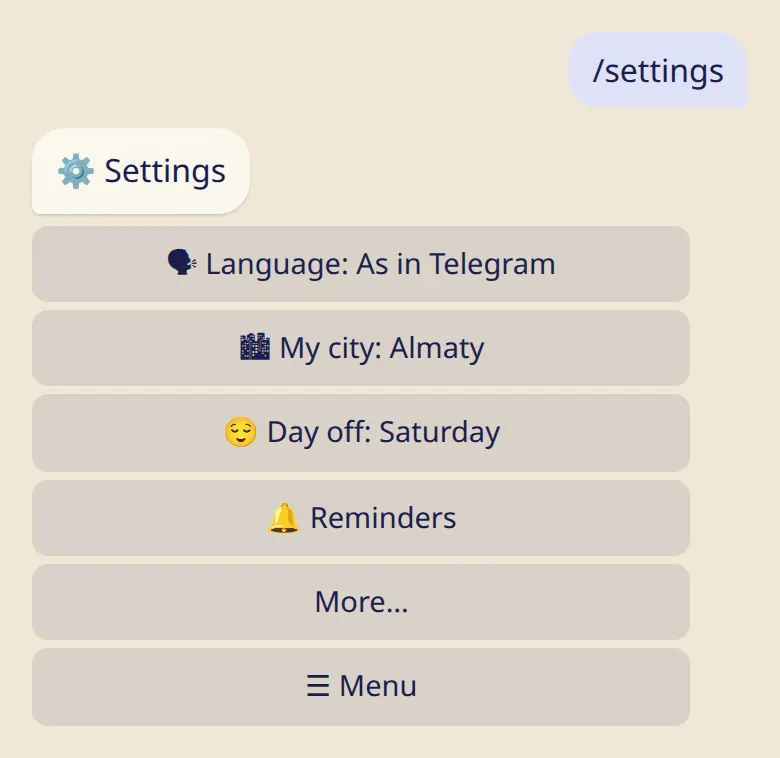
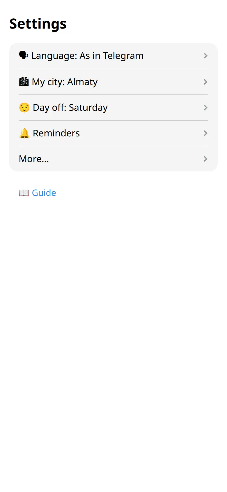
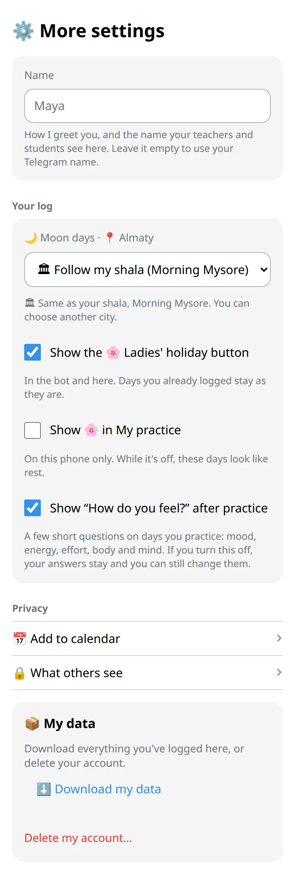

Your name, language and city, and whose moon days you follow.

## Where the settings are

- **In the bot:** :ftl[menu-open] → :ftl[menu-settings].
- **In the app:** the gear :ftl[settings-open]{from=app} in the top corner of any tab.

Both have the same five rows. Language, city and day off show what is set now. Then come :ftl[settings-reminders-button], and :ftl[settings-more-button] for everything else. Tap a row to change it.

## Your city

Your city sets your clock, so reminders come at the right hour and days get the right date.

1. Tap the second row, the one with your city, and pick your city. Until you do, the row itself asks: :ftl[settings-city-unset-line]{zone="UTC+5"}.
2. Not on the list? Tap :ftl[settings-city-unlisted]. You can send your location once, or let the app use your phone's time.

A location you send is used only to find the local time there. It isn't stored.

Traveling? When your phone's time differs, the app asks whether to switch or keep your home time. It never changes it silently.

## Whose moon days

:ftl[settings-more-button] → :ftl[settings-moon-link] in the bot chooses the city your moon days are calculated for. In the app it is the list under :ftl[settings-log-title], also behind :ftl[settings-more-button]. The city can be different from the one you live in, for example your teacher's.

## The rest

- **Language:** as in Telegram, English or Russian.
- **Name:** how the bot greets you, and what your teachers see. Change it in the app: :ftl[settings-more-button], the first field.
- **Day off:** see [Rest days, moon days and 🌸](../rest-and-moon-days/).
- **Reminders:** see [Reminders](../reminders/). Quiet hours and the daily limit are there, in the app.
- :ftl[settings-more-button] in the app also has the 🌸 switches, :ftl[settings-checkin], the calendar link, :ftl[settings-privacy-open] and :ftl[data-title]{from=app}.

## Good to know

- Days you already logged keep their dates when you change your city.
- The bot's command menu stays in your Telegram language, even if you choose another one here.
- In the bot, :ftl[settings-more-button] → :ftl[settings-open-app] opens the app's settings.

## Next

- [Your data: privacy, export, delete](../your-data/)
