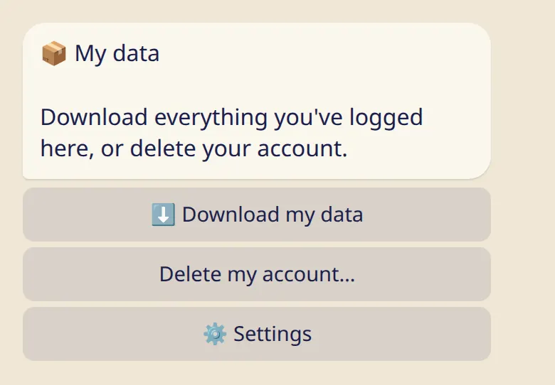

What is private, what a teacher sees, how to download everything you logged, and how to delete your account.

## Private by default

- Your log is yours. Without a teacher on your list, nobody else sees any of it.
- Diary notes and 🌸 days are stored encrypted.
- Check-ins, diary notes, badges and the reason for a rest day are never shown to anyone.
- A teacher you add sees your name, practice or rest from the day you add them, your practice length and your last asana, and a short note if nothing shows for a while. A shala sees your name and your class attendance marks.

More detail: [My teacher](../my-teacher/) and [Privacy in plain words](../../reference/privacy/).

## Download your data

1. Send :cmd[settings] and tap :ftl[settings-data-button].
2. Tap :ftl[export-button]{from=bot}.

The bot sends one ZIP file to your chat. Inside are a `data.json` for apps and CSV files for spreadsheets. It contains your private entries too, so once you have saved it, you may want to delete it from the chat.

## Delete your account

On the same screen, tap :ftl[delete-button] and confirm.

- Everything is deleted right away: days, practices, check-ins, diary notes, your asanas, teacher and student lists, settings.
- It can't be undone. Download your data first if you want to keep it.
- Copies in backups disappear within 30 days.
- Messages in your Telegram chat stay until you clear the chat.
- If you own a shala, it is deleted for everyone in it. Their own logs stay.

If you write to the bot again later, it starts fresh.

## Next

- [Questions and answers](../../reference/faq/)
