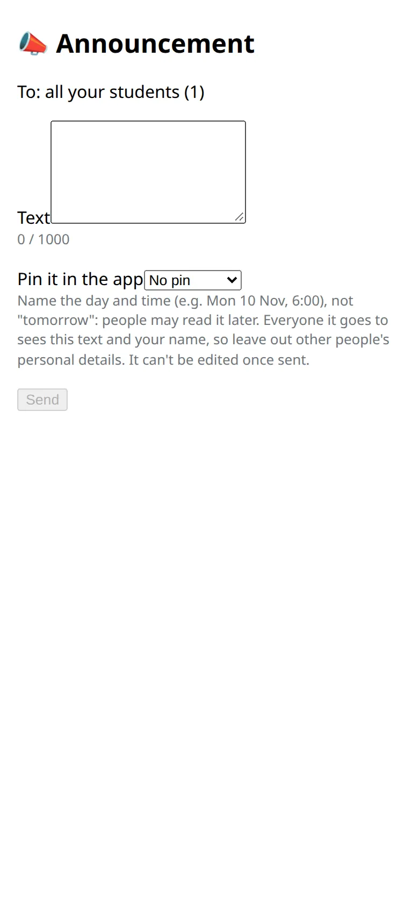

Send a short message to all your students: a schedule change, a workshop, a day off.

## Write one

1. Open your students list and tap :ftl[ann-announce]. In the bot this button opens the form in the app.
2. Write the text, up to 1000 characters.
3. If you like, pin it: :ftl[ann-pin-week] or :ftl[ann-pin-month] keeps it at the top of your students' announcements in the app.
4. Tap :ftl[ann-send] and confirm.

## How it arrives

Each student gets a message from the bot within about 10 minutes, with your name above the text. During a student's quiet hours it arrives without a sound.

Under the message is :ftl[ann-mute]. A student who taps it stops getting the messages and can still read your announcements in the app. You aren't told who did.

## After you send it

- An announcement can't be edited.
- :ftl[ann-delete] takes it out of the app and stops it from going to anyone who hasn't received it yet. Messages already delivered stay in people's chats.
- For a typo, delete it and send it again.
- Your sent announcements stay on the form's screen for 30 days.

## Good to know

- You can send up to 3 announcements in 24 hours.
- Name the day and the time, for example "Mon 16 Nov, 6:00", not "tomorrow". People may read it later.
- It goes to all your students at once. Everyone sees the text and your name, so leave out other people's personal details.
- To write to everyone in a shala, students and team, see [Shala announcements](../../staff/announcements/).

## Next

- [Moon days your students follow](../moon-days/)
