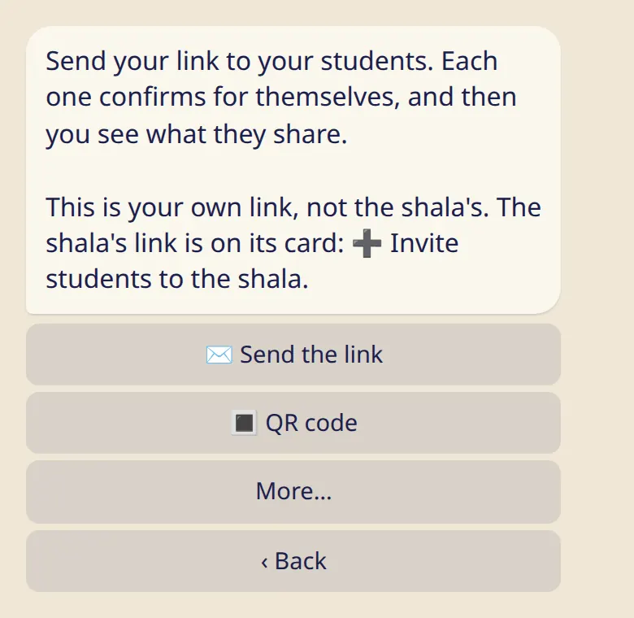
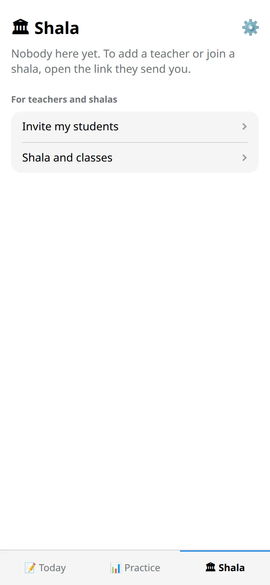
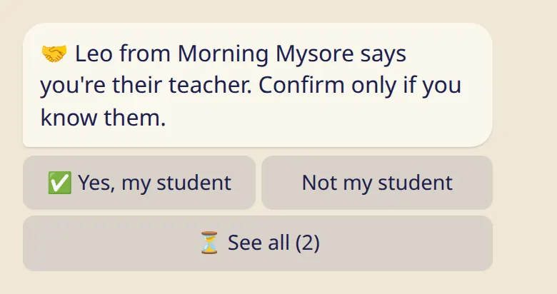
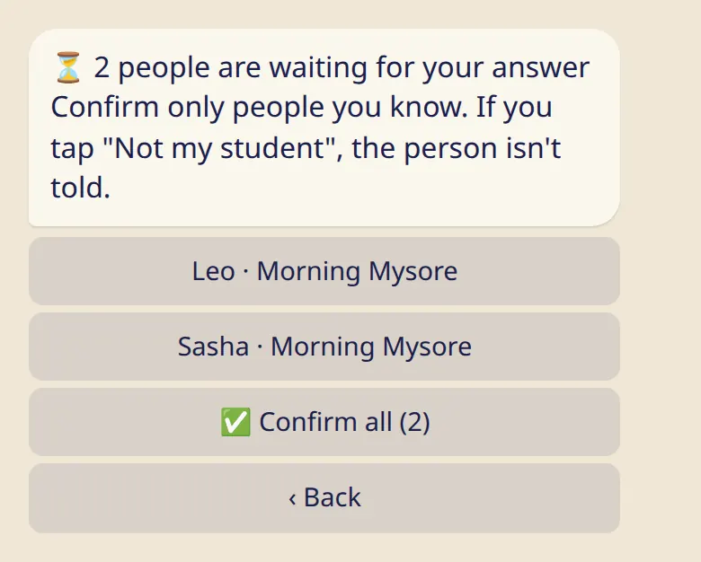
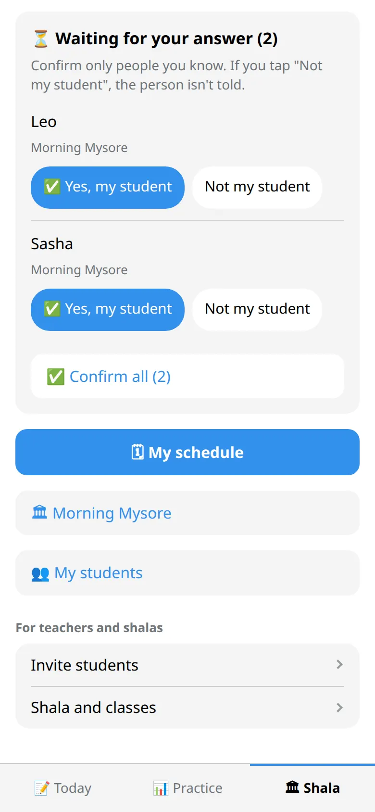

Two ways to connect with a student: send your own link, or say yes when they pick you at your shala.

## Get your link

1. The first time, open :ftl[menu-open] → :ftl[menu-teach] and tap :ftl[welcome-path-invite]. Already on a shala's team? Then the row is :ftl[links-invite-first], under :ftl[menu-teacher].
2. Once you have students, it is :ftl[menu-open] → :ftl[menu-students] → :ftl[links-invite].
3. :ftl[invite-send] sends your personal link to a chat. :ftl[invite-qr] makes a picture you can show on your phone or print for the shala wall. :ftl[invite-more] shows the link as text.

In the app the same link is on the :ftl[tab-shala] tab: tap :ftl[shala-start-invite].

There is no teacher account to apply for. If you teach, you send your link, and that's all.

## What your student does

Each student opens the link and confirms for themselves. Before they confirm, the bot shows them exactly what you would see. You can't add anyone yourself.

- When a student confirms, you get a message without a sound, and they appear under :ftl[menu-students].
- If they tap :ftl[invite-decline], you aren't told.

## When a student picks you at a shala

Do you have the :ftl[shala-role]{role=teacher} role at a shala? Then a student who joins it can pick you as their teacher. You don't send them anything, and nothing from their log is shown until you say yes.

1. You get a message without a sound: who says you're their teacher, and at which shala.
2. Know them? Tap :ftl[request-yes-mine]. They are on your list, and you see their days from the date they asked.
3. Not your student? Tap :ftl[request-not-mine]. The person isn't told. :ftl[request-undo] takes it back.

Everyone still waiting is in one list. In the bot it is the row :ftl[request-waiting-open]{count=2} at the top of :ftl[menu-students] and on the shala's card. :ftl[request-all]{count=2} confirms everyone on the list you are looking at.

In the app the list is at the top of the :ftl[tab-shala] tab, with :ftl[request-yes-mine] and :ftl[request-not-mine] under each name.

- Confirm only people you know.
- A request waits for 7 days. After that, send the student your own link.
- Nobody else at the shala sees who picked you.
- Your own link works as before: a student opens it, confirms, and is on your list straight away.

## If your link got out

Tap :ftl[invite-more], then :ftl[invite-new] and confirm. The old link and QR code stop working. People already on your list stay.

## Remove a student

Tap the student's name in your list, then :ftl[links-remove]. Nobody gets a message.

## Good to know

- One link works for all your students, and it doesn't expire.
- You can have up to 500 students.
- You can be a teacher and a student in the same account.
- Students who haven't chosen a moon city follow the one you choose: see [Moon days your students follow](../moon-days/).

## Next

- [What you see, and what you never see](../what-you-see/)
