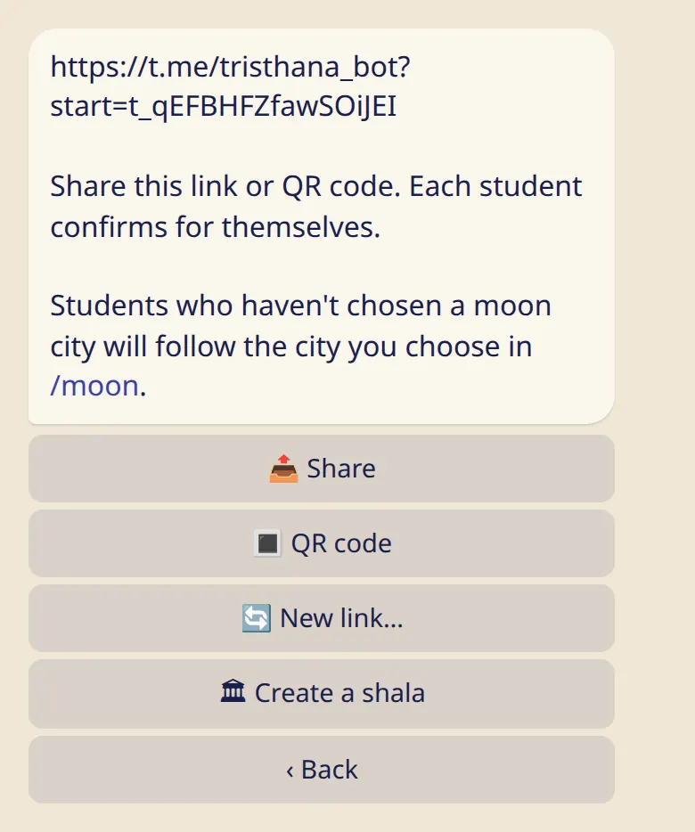

Share a link or show a QR code. A student confirms, and you are connected.

## Get your link

1. Send :cmd[teachers].
2. Tap :ftl[links-invite-first] the first time, or :ftl[links-invite] once you have students.
3. The bot shows your personal link. :ftl[invite-share] sends it to a chat. :ftl[invite-qr] makes a picture you can show on your phone or print for the shala wall.

In the app the same link is under :ftl[settings-open] → :ftl[links-title].

There is no teacher account to apply for. If you teach, you share your link, and that's all.

## What your student does

Each student opens the link and confirms for themselves. Before they confirm, the bot shows them exactly what you would see. You can't add anyone yourself.

- When a student confirms, you get a message without a sound, and they appear under :ftl[link-students-open].
- If they tap :ftl[invite-decline], you aren't told.

## If your link got out

Tap :ftl[invite-new]. The old link and QR code stop working. People already on your list stay.

## Remove a student

Tap the student's name in your list, then :ftl[links-remove]. Nobody gets a message.

## Good to know

- One link works for all your students, and it doesn't expire.
- You can have up to 500 students.
- You can be a teacher and a student in the same account, with your own teachers on the same screen.
- Students who haven't chosen a moon city follow the one you choose: see [Moon days your students follow](../moon-days/).

## Next

- [What you see, and what you never see](../what-you-see/)
