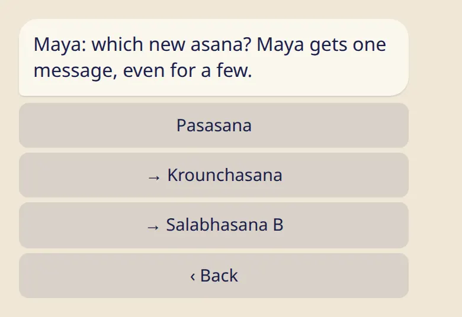

Gave a student a new asana? Mark it in a few taps, and they get a small celebration.

## Mark it

1. Open the student's card: :cmd[teachers] → :ftl[link-students-open] → the name.
2. Tap :ftl[students-give].
3. Choose the asana. The first row is the next one in the series. Rows with → mark several at once, up to three.
4. Tap :ftl[students-give-yes].

The same button is on the student's card in the app.

## What your student gets

One message from the bot with a small celebration, even if you marked a few asanas. Their :ftl[progression-open] screen shows that a teacher marked it, with your name.

The student can undo your mark if it doesn't match their practice, until their practice moves on from it. It's their record, so they have the last word.

## Good to know

- You can mark forward only, up to three asanas at a time. Asanas given together, such as Salabhasana A and B, count as one. Anything else, such as moving back or setting a different series, the student changes in :ftl[progression-open].
- If the student hasn't set their last asana yet, the card says so. Ask them to set it once, and then you can mark new ones.
- The list crosses from one series to the next: after Setu Bandhasana comes Pasasana.
- Any teacher on the student's list can mark an asana. A shala's team can't, unless the student added them as a teacher.
- You can't undo your own mark. If you tapped the wrong row, ask the student to undo it.

## Next

- [Announcements](../announcements/)
