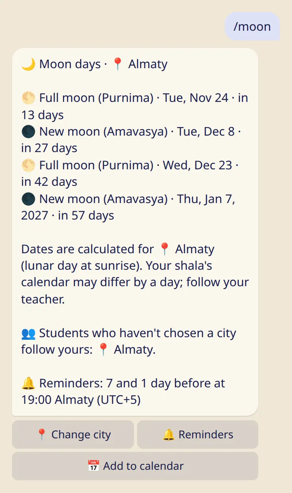

Students can follow your moon-day calendar, so your room can rest on the same days.

## How it works

A student who hasn't chosen a moon city follows the city their main teacher chose. So when you choose yours, your students rest on the same days as you, without setting anything up.

## Choose your city

1. Send :cmd[moon].
2. Tap :ftl[moon-change-city] and pick the city your room follows.

The line with 👥 says what your students follow now.

## What a student follows, in order

1. A city the student chose themselves.
2. The city their main teacher chose.
3. Their shala's calendar.
4. Mysuru.

If the main teacher teaches at the student's shala, the shala's calendar comes before the teacher's city.

## Good to know

- Only a city you chose yourself passes to your students. If your own moon days follow your teacher or your shala, your students don't get them through you.
- If you never chose a city and your moon days followed your own teacher, that stops when your first student joins. The bot tells you and offers to keep that city in one tap.
- It goes one step only: your students' students follow their own teacher, not you.
- A student can choose their own city at any time, and that choice always wins.
- Dates are calculated for the city, by the lunar day at sunrise. If your shala observes another day, tell your students. The bot tells them to follow their teacher. See [How moon days are calculated](../../reference/moon-calculation/).

## Next

- [The SYC directory line](../directory-line/)
