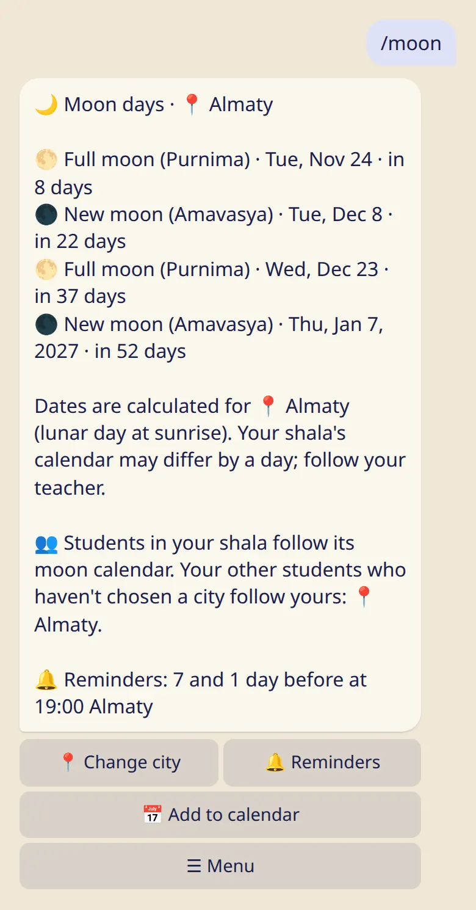

Students can follow your moon-day calendar, so your room can rest on the same days.

## How it works

A student who hasn't chosen a moon city follows the city their main teacher chose, unless that teacher is on the staff of the student's shala: then the student follows the shala. So when you choose your city, your own students rest on the same days as you, without setting anything up.

## Choose your city

1. Open :ftl[menu-open] → :ftl[menu-moon].
2. Tap :ftl[moon-change-city] and pick the city your room follows.

The line with 👥 says what your students follow now. If you are on a shala's staff, it also says that students in that shala follow the shala's calendar, whichever city you choose.

## In a shala

On the shala's card the owner and managers read :ftl[shala-moon-shared] There is one exception: a student whose main teacher is not on that shala's staff follows the city that teacher chose, if they chose one. A student whose main teacher teaches at the shala follows the shala.

## What a student follows, in order

1. A city the student chose themselves, or their choice to follow their teacher or their shala.
2. Their shala's moon days, if they are on its staff themselves.
3. Their shala's moon days, if their main teacher is on that shala's staff.
4. The city their main teacher chose, if the student has no students of their own.
5. Their shala's moon days.
6. Mysuru.

## Good to know

- Only a city you chose yourself passes to your students. If your own moon days follow your teacher or your shala, your students don't get them through you.
- If you never chose a city and your moon days followed your own teacher, that stops when your first student joins. The bot tells you and offers to keep that city in one tap.
- The same when you join a shala's staff with students of your own and no city chosen: your moon days follow the shala, and the bot offers to keep the shala's city as your own, so your students follow it too.
- It goes one step only: your students' students follow their own teacher, not you.
- A student can choose their own city at any time, and that choice always wins.
- Dates are calculated for the city, by the moon at sunrise there. If your shala observes another day, tell your students. The bot tells them to follow their teacher. See [How moon days are calculated](../../reference/moon-calculation/).

## Next

- [The SYC directory line](../directory-line/)
