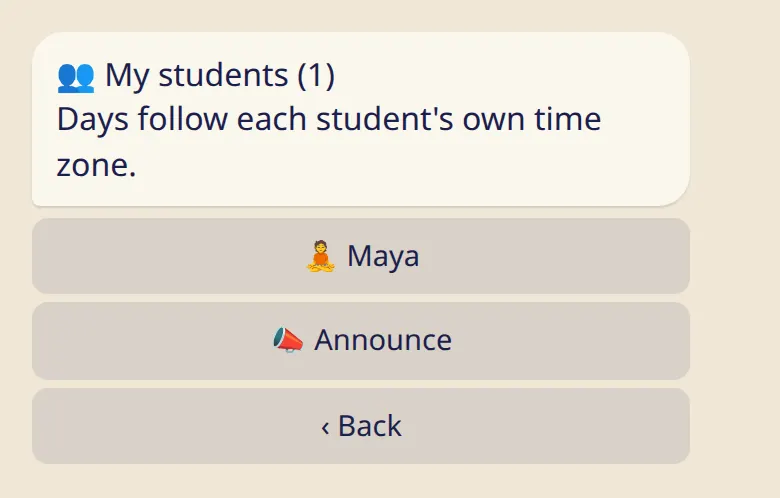
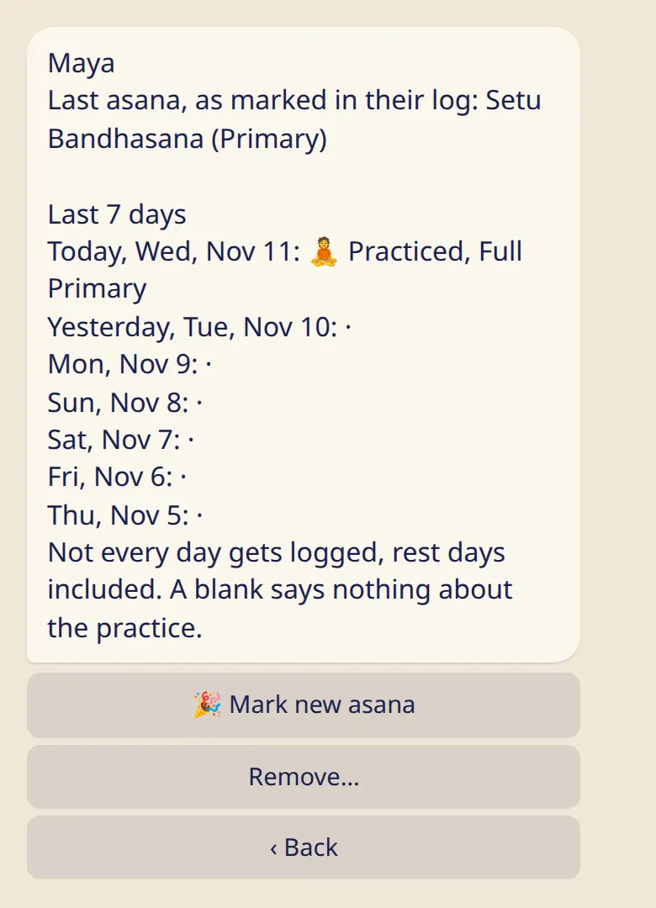
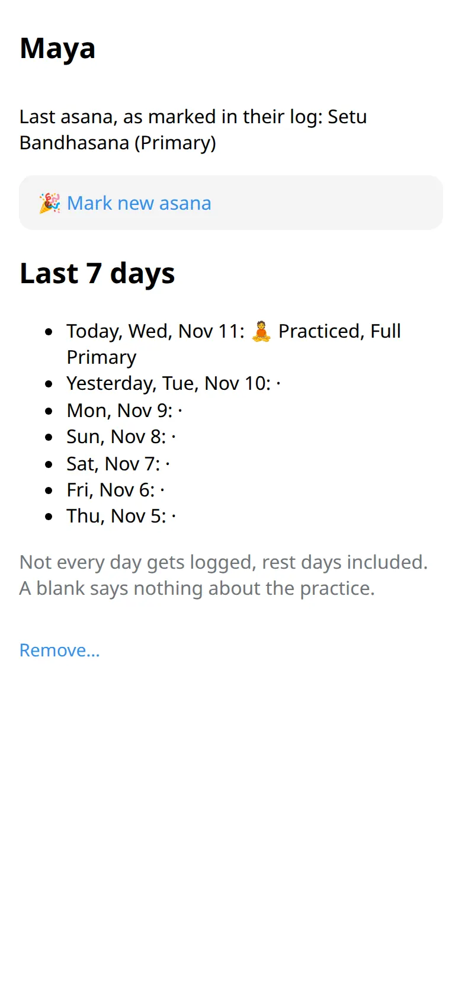

Your students list and each student's card. Diary notes, check-ins and the reason for a rest always stay with the student.

## Your students

Send :cmd[teachers] and tap :ftl[link-students-open]. In the app it is under :ftl[settings-open] → :ftl[links-title].

Next to each name is today's mark: 🧘 for practice, 😌 for rest. A name with no mark means there is nothing to show for today.

## A student's card

Tap a name to open the card.

- **The last asana**, as the student marked it in their own log.
- **The last 7 days**: practice or rest, and for a practice its length, for example Full Primary.

Days follow each student's own time zone, so their "today" may not be yours.

## What a blank means

A "·" means there is nothing to show for that day. Not every day gets logged, rest days included, and days before the student added you are always blank. A blank says nothing about their practice.

After about three weeks with nothing to show, the card adds one line: :ftl[students-quiet]. It gives no reason.

## What you never see

- Check-ins and diary notes.
- The reason for a rest. A moon day, a day off, travel, a sick day and 🌸 all look the same to you: 😌 rest.
- Any day before the date they added you, even if they fill it in later.
- Their badges, counts and statistics.
- The history of their asanas. You see only where they are now.

There is no setting that shows you more.

## Good to know

- The card is for reading. You can't change a student's log. The one thing you can add is a new asana: see the next page.
- A shala's team sees students' names and nothing from their logs. To see a student's card, share your own teacher link with them.
- A student can remove you from their list at any time. You don't get a message.

## Next

- [Mark a new asana](../mark-new-asana/)
